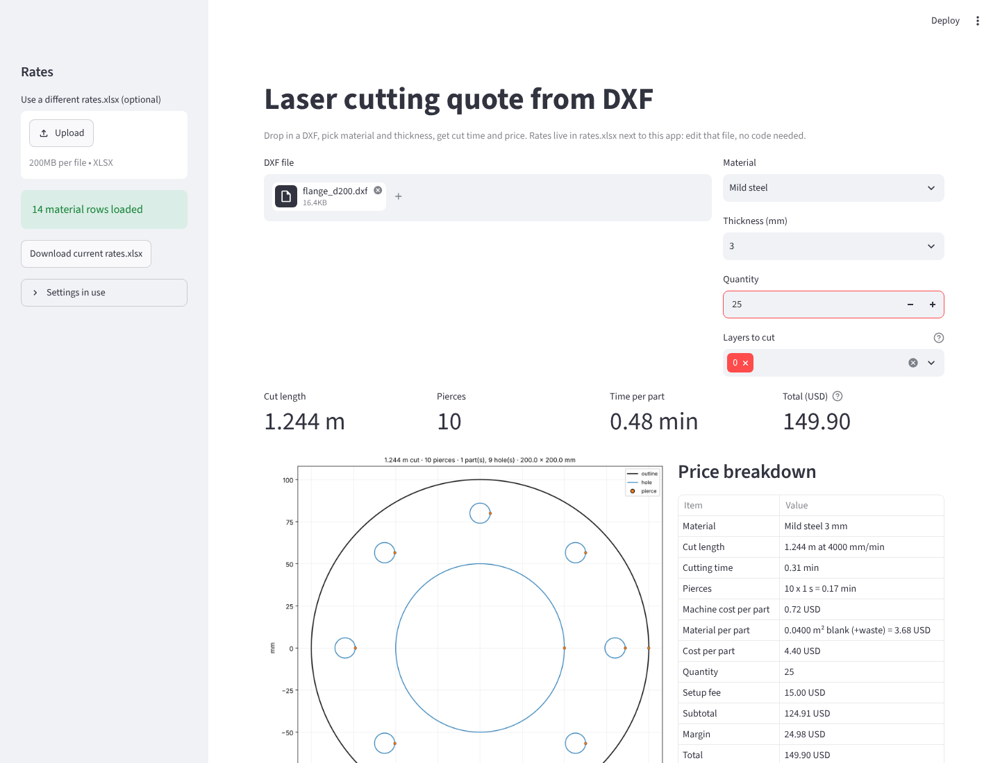
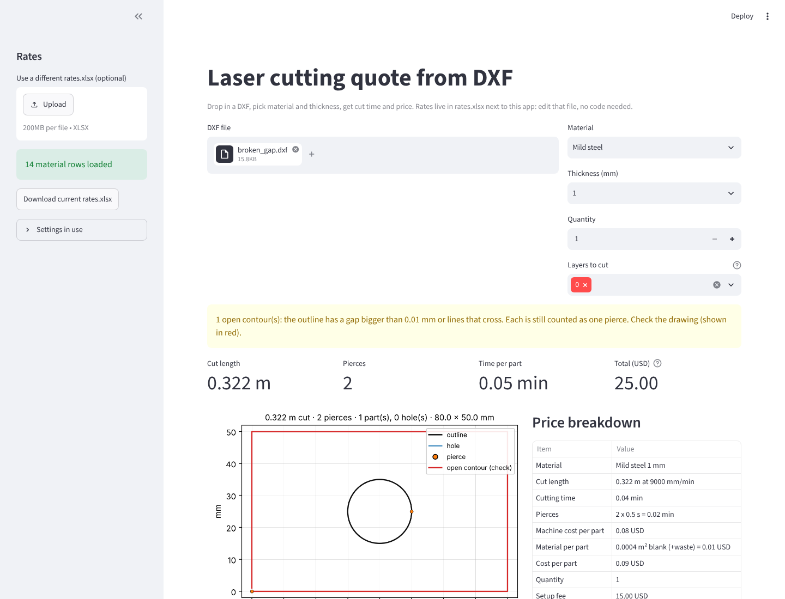

# dxf-laser-quote

Drop in a DXF, pick material and thickness, get cut time and a price.
Built for a small laser cutting shop with no IT staff: the rates live in an
Excel file the shop edits itself.



## What it does

1. Reads the DXF with [ezdxf](https://ezdxf.mozman.at/) (recover mode, so slightly broken exports still open).
2. Measures what the laser has to cut, in millimetres:
   - **cut length** — lines, arcs, circles and polylines (with bulges) measured exactly; splines and ellipses on a fine approximation
   - **pierces** — one per contour. Loose lines and arcs that touch end to end are joined into one contour, so a rectangle drawn as four lines is one pierce
   - parts vs. holes, overall size, blank area (bounding box per part) and net area
   - blocks are exploded with their scale; inch drawings are converted
   - bend, text, dimension and similar layers are skipped by default (editable in the app)
   - duplicate entities drawn on top of each other are counted once
3. Prices it from `rates.xlsx`:
   ```
   cut time      = cut length / cut speed + pierces × pierce time
   machine cost  = cut time × machine rate
   material cost = blank area × (1 + waste %) × price per m²
   order         = (per part × qty + setup fee) × (1 + margin %)
   final         = max(order, minimum order)
   ```
   Every step is shown in the breakdown, so a wrong number is easy to trace.
4. Shows the contours it counted. Open contours (a gap in the outline) are drawn in red with a warning, because they usually mean the file needs fixing before it goes to the machine.



## Run it

```
pip install -r requirements.txt
streamlit run app.py
```

`rates.xlsx` is created next to the app on first run with placeholder numbers.
Edit the **Materials** sheet (one row per material + thickness) and the
**Settings** sheet (machine rate, setup fee, minimum order, margin, waste,
currency). The app re-reads the file every time it runs. You can also upload a
different rates file in the sidebar.

Sample files with known answers are in `samples/` (made by `samples/make_samples.py`).

## Checks

`pytest` runs 20 tests. Each geometry test draws a part whose length and pierce
count are known by hand and checks the result against that:

| sample | expected cut length | measured |
|---|---|---|
| flange d200, d100 bore, 8 × d12 holes | 2π(100 + 50 + 8·6) = 1244.07 mm | 1244.07 mm, 10 pierces |
| gusset 6 × 4 in + d0.5 in hole (inch file) | (6 + 4 + √52 + π/2) × 25.4 = 477.06 mm | 477.06 mm, 2 pierces |
| 4 tags 60 × 40 as block inserts, d5 hole each | 4 × (200 + 5π) = 862.83 mm | 862.83 mm, 8 pierces |
| rectangle with a 0.5 mm gap | — | flagged as open contour |

Pricing is checked the same way: the test recomputes the formula by hand for a
100 × 50 plate in 3 mm steel, qty 10, and compares.

## Limits (as of now)

- DXF only. STEP needs a flat pattern first; PDF prints need vector extraction and scanned prints can't be measured reliably.
- Material cost uses each part's bounding box plus a waste percentage. Real nesting on a sheet is not simulated.
- If the outer outline is open, the parts inside it can't be told apart from holes, and the blank area is only what closed contours give. Fix the gap in CAD, or raise the join tolerance if it is only CAD rounding.
- Cut speed is one number per material/thickness. Slow-down on small holes and corners is not modelled; fold it into the pierce time or the speed.
- The placeholder rates are not real prices. Replace them with the shop's own.

## Layout

```
app.py                  Streamlit page
laserquote/geometry.py  DXF → cut length, pierces, parts/holes, areas
laserquote/pricing.py   rates.xlsx → price, with breakdown
laserquote/preview.py   drawing of what was counted
samples/                sample DXFs + the script that makes them
tests/                  pytest, known-answer tests
docs/                   screenshots and the script that takes them
```
